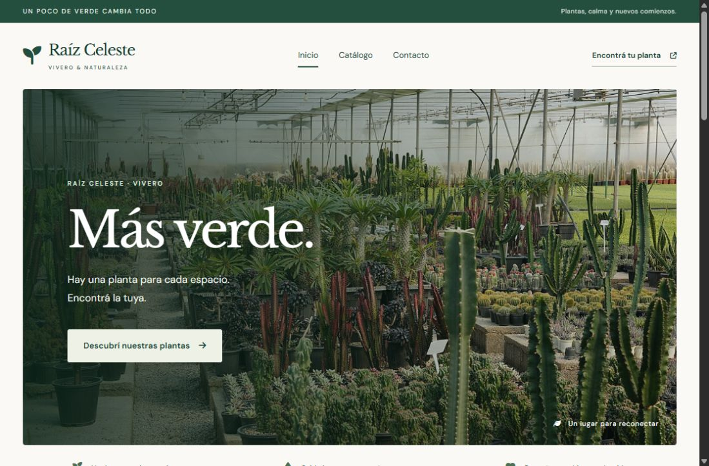
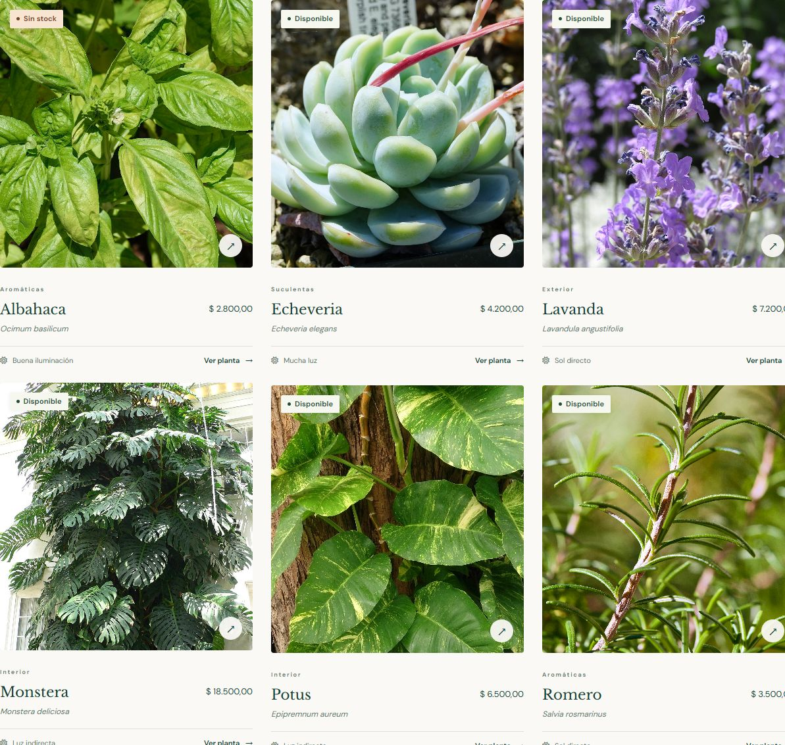

# Proyecto Final Codo a Codo 2022 - Full Stack Python

## Raíz Celeste · Vivero y catálogo de plantas


**Raíz Celeste** es una aplicación web de un vivero que combina un catálogo público
con un panel de administración para gestionar plantas y categorías. Integra una
interfaz responsive, una API desarrollada con Flask y persistencia en MySQL.

> Proyecto desarrollado con fines académicos para integrar los contenidos del curso
> **Codo a Codo 4.0 — Full Stack Python, edición 2022**. La implementación utiliza
> versiones actuales de las tecnologías estudiadas; por ejemplo, Vue 3.

**Nota sobre el historial:** Proyecto desarrollado en 2022 e incorporado a GitHub en 2026. Los archivos originales no conservaban su historial de Git.



## Objetivos del proyecto

- Aplicar HTML semántico, CSS y JavaScript en un sitio con identidad visual propia.
- Construir interfaces reactivas con Vue y formularios con Bootstrap.
- Conectar el Front-End con una API HTTP mediante `fetch` y JSON.
- Implementar operaciones **CRUD**: crear, consultar, actualizar y eliminar registros.
- Modelar datos relacionados en MySQL y validar la información en distintas capas.
- Documentar la instalación y organizar el código para facilitar su comprensión.

## Funcionalidades

### Sitio público

- Inicio con plantas destacadas y accesos por ambiente.
- Catálogo con fotografía, categoría, nombre científico, precio y disponibilidad.
- Búsqueda por nombre y filtros por categoría y stock.
- Ficha individual con descripción, recomendaciones de luz y riego.
- Formulario de contacto con validación en JavaScript.
- Mapa de referencia integrado mediante iframe.
- Página de créditos con autores, fuentes y licencias de las fotografías.

### Panel de administración

- Alta, consulta, edición y eliminación de plantas.
- Gestión de categorías.
- Actualización de precios, stock, imágenes y plantas destacadas.
- Confirmación antes de eliminar registros.
- Protección de categorías con plantas asociadas mediante una clave foránea.
- Mensajes de carga, errores y confirmación de operaciones.



## Tecnologías utilizadas

| Área | Tecnología | Aplicación |
|---|---|---|
| Estructura | HTML5 y plantillas Jinja2 | Páginas semánticas, base compartida y componentes reutilizables |
| Diseño | CSS3, Flexbox y CSS Grid | Identidad visual, tarjetas, formularios y diseño responsive |
| Interactividad | JavaScript | Validación, eventos y solicitudes HTTP con Fetch API |
| Interfaz reactiva | Vue 3.5.13 | Catálogo, filtros, fichas y administración |
| Componentes visuales | Bootstrap 5.3.3 | Estilos del formulario de contacto |
| Lenguaje del servidor | Python 3.10 o superior | Lógica de la aplicación y validaciones |
| Framework web | Flask 3.1 o superior, anterior a 4 | Rutas, API, respuestas JSON y renderizado HTML |
| Base de datos | MySQL 8.0.16 o superior | Tablas relacionadas, índices y restricciones de integridad |
| Conector | MySQL Connector/Python 9.x | Conexión y consultas SQL parametrizadas |
| Configuración | python-dotenv | Lectura de variables de entorno desde `.env` |
| Iconografía | Font Awesome 6.7.2 | Navegación, cuidados y acciones |
| Tipografía | Google Fonts: DM Sans y Libre Baskerville | Textos de interfaz y títulos |
| Versionado | Git y GitHub | Historial del código y documentación |
| Herramienta opcional | MySQL Workbench | Creación e inspección de la base de datos |

Vue, Bootstrap, Font Awesome y las fuentes se cargan mediante servicios externos y
requieren conexión a internet. Las fotografías se incluyen dentro del proyecto.
No se necesita Node.js ni un proceso de compilación para ejecutar la aplicación.

**Bootstrap se utiliza únicamente en la página de contacto**, respetando la
restricción del TPO de Front-End utilizado como referencia.

## Arquitectura

```text
Navegador: HTML + CSS + JavaScript + Vue
                  │
                  │ HTTP / Fetch / JSON
                  ▼
          Flask: páginas y API
                  │
                  │ MySQL Connector/Python
                  │ consultas parametrizadas
                  ▼
                 MySQL
```

Flask sirve las páginas y la API desde el mismo origen. El código del servidor
separa las rutas de páginas, las operaciones de la API y el acceso a datos.

## Estructura del repositorio

```text
.
├── app.py                         # Punto de entrada de Flask
├── requirements.txt               # Dependencias de Python
├── .env.example                   # Configuración de ejemplo, sin credenciales
├── .gitignore
├── iniciar.ps1                    # Inicio local para Windows
├── raiz_celeste/
│   ├── __init__.py                 # Creación de la aplicación y manejo de errores
│   ├── pages.py                    # Rutas de las páginas
│   ├── api.py                      # API CRUD y validaciones
│   └── db.py                       # Conexión y consultas MySQL
├── database/
│   ├── 01_schema.sql               # Base, tablas, índices y restricciones
│   ├── 02_seed.sql                 # Datos de demostración
│   └── 03_fotografias.sql           # Actualización de imágenes provisionales
├── templates/                     # Plantillas HTML, parciales y administración
├── static/
│   ├── css/                       # Estilos generales e identidad visual
│   ├── js/                        # Catálogo, API, contacto y administración
│   └── img/                       # Fotografías y recursos gráficos
└── docs/
    ├── alcance.md                 # Correspondencia con las consignas
    ├── verificacion.md            # Comprobaciones realizadas
    ├── fotografias.md             # Créditos y licencias
    ├── fotografias.json           # Datos de la página de créditos
    └── images/                    # Capturas de pantalla
```

## Instalación y ejecución

### 1. Requisitos

- Python 3.10 o superior.
- MySQL 8.0.16 o superior en ejecución.
- Git para clonar el repositorio.
- Acceso a internet para instalar dependencias y cargar los recursos CDN.

### 2. Clonar el repositorio

```bash
git clone https://github.com/M-Celeste/proyecto-final-codo-a-codo-2022-full-stack-python.git
cd proyecto-final-codo-a-codo-2022-full-stack-python
```

### 3. Crear el entorno virtual e instalar dependencias

En **Windows / PowerShell**:

```powershell
py -m venv .venv
.\.venv\Scripts\python.exe -m pip install -r requirements.txt
Copy-Item .env.example .env
```

En **Linux o macOS**:

```bash
python3 -m venv .venv
.venv/bin/python -m pip install -r requirements.txt
cp .env.example .env
```

El archivo `.env` debe crearse únicamente en la primera instalación; conservarlo
si la aplicación ya está configurada.

### 4. Configurar MySQL

Editar `.env` con los datos de una cuenta local que pueda acceder a la base:

```dotenv
MYSQL_HOST=127.0.0.1
MYSQL_PORT=3306
MYSQL_USER=tu_usuario_mysql
MYSQL_PASSWORD=tu_contrasena_mysql
MYSQL_DATABASE=raiz_celeste
```

Las credenciales reales no se incluyen en este repositorio. `.env` está excluido
del control de versiones; `.env.example` sirve como plantilla.

### 5. Crear la base e importar datos

Desde MySQL Workbench, abrir y ejecutar en este orden:

1. `database/01_schema.sql`
2. `database/02_seed.sql`

También pueden ejecutarse desde la consola de MySQL, usando la ruta del clon:

```sql
SOURCE C:/ruta/del/proyecto/database/01_schema.sql;
SOURCE C:/ruta/del/proyecto/database/02_seed.sql;
```

El esquema crea la base `raiz_celeste`. Los datos iniciales contienen **4 categorías
y 6 plantas** con precios ficticios en pesos argentinos. La segunda importación
no duplica los nombres ya presentes ni sobrescribe los registros editados.

Para actualizar una instalación anterior que conserve las ilustraciones
provisionales, ejecutar además `database/03_fotografias.sql`. Este script conserva
las fotografías que se hayan cargado manualmente.

### 6. Ejecutar Flask

En **Windows / PowerShell**:

```powershell
.\.venv\Scripts\python.exe -m flask --app app run --debug
```

En **Linux o macOS**:

```bash
.venv/bin/python -m flask --app app run --debug
```

Abrir **http://127.0.0.1:5000/**. Detener el servidor con `Ctrl+C`.

En Windows, una vez configurado el entorno, `iniciar.ps1` permite iniciar la
aplicación en segundo plano y abrir el navegador. El sitio debe ejecutarse con
Flask: abrir los HTML directamente o usar Live Server no ejecuta el Back-End.

## Modelo de datos

```text
categorias (1) ─────────── (N) plantas
    id                       id
    nombre                   categoria_id → categorias.id
    descripcion              nombre, nombre_cientifico, descripcion
                             precio, stock, imagen
                             luz, riego, destacada, creada_en
```

- Cada planta pertenece a una categoría.
- El nombre de categoría es único.
- El precio debe ser positivo y el stock debe ser un entero no negativo.
- Un stock igual a cero se muestra como **Sin stock**.
- La base impide eliminar categorías con plantas asociadas.
- Las fotografías se guardan como archivos o URLs; la tabla almacena su ubicación.

## Páginas principales

| Ruta | Contenido |
|---|---|
| `/` | Inicio y plantas destacadas |
| `/catalogo` | Catálogo, búsqueda y filtros |
| `/plantas/<id>` | Ficha de la planta |
| `/contacto` | Formulario y mapa de referencia |
| `/creditos` | Autores y licencias de las fotografías |
| `/admin/plantas` | Administración de plantas |
| `/admin/plantas/nueva` | Alta de planta |
| `/admin/plantas/<id>/editar` | Edición de planta |
| `/admin/categorias` | Administración de categorías |

## API

| Recurso | Métodos disponibles |
|---|---|
| `/api/plantas` | `GET` listar · `POST` crear |
| `/api/plantas/<id>` | `GET` consultar · `PUT` actualizar · `DELETE` eliminar |
| `/api/categorias` | `GET` listar · `POST` crear |
| `/api/categorias/<id>` | `GET` consultar · `PUT` actualizar · `DELETE` eliminar |

Filtros del listado de plantas: `q`, `categoria_id`, `disponibles=1` y
`destacadas=1`. Ejemplo: `/api/plantas?q=Monstera&disponibles=1`.

`POST` y `PUT` reciben JSON. `PUT` reemplaza los campos editables; no es una
actualización parcial. Las respuestas utilizan estados HTTP como `201` al crear,
`204` al eliminar, `400` por datos inválidos, `404` por recursos inexistentes,
`409` por conflictos de integridad y `503` por problemas de conexión a MySQL.

## Consignas y validación

El proyecto contempla páginas HTML, etiquetas semánticas, formulario validado con
JavaScript, iframe, íconos, fuentes, Flexbox/Grid, transiciones y tres puntos de
corte responsive: **576, 768 y 1024 px**. La transición de las tarjetas está
identificada en las hojas de estilos.

Se realizaron comprobaciones de CRUD, filtros, integridad referencial,
validaciones y carga de imágenes. El diseño se revisó en vistas de escritorio,
tablet y celular. El detalle está documentado en:

- [Alcance y correspondencia con las consignas](docs/alcance.md)
- [Verificaciones realizadas y recorrido manual](docs/verificacion.md)

Estas comprobaciones están registradas como validación del desarrollo; el
repositorio no incluye actualmente una suite automatizada ni un flujo de CI.

## Alcance de la demostración

Esta versión está preparada para **ejecución local y presentación académica**.

- El formulario de contacto valida los datos, pero no envía correos ni guarda consultas.
- El panel de administración aún no implementa autenticación ni autorización.
- No incluye carrito, pagos, reservas, envíos ni carga de archivos desde el navegador.
- Los precios, el stock, el mapa y los textos comerciales son datos de demostración.
- Las fotografías son referencias botánicas; no muestran inventario ni instalaciones propias.
- El despliegue público de la aplicación está pendiente. GitHub aloja el código;
  GitHub Pages no ejecuta este servidor Flask ni su base MySQL.

Antes de exponer las operaciones de administración en internet se debe incorporar
control de acceso y completar la preparación del entorno de producción.

## Créditos

**Autora del proyecto:** [M-Celeste](https://github.com/M-Celeste).

**Contexto académico:** Codo a Codo 4.0 — Full Stack Python, edición 2022.
El repositorio presenta una implementación educativa y no constituye un sitio
oficial del programa ni acredita por sí mismo una entrega o aprobación del curso.

Las fotografías provienen de Wikimedia Commons y conservan sus licencias.
Consultar [autores, fuentes y condiciones de uso](docs/fotografias.md).

## Referencias técnicas

- [Documentación de Flask](https://flask.palletsprojects.com/)
- [Documentación de Vue](https://vuejs.org/guide/)
- [Documentación de Bootstrap](https://getbootstrap.com/docs/5.3/)
- [MySQL Connector/Python](https://dev.mysql.com/doc/connector-python/en/)

---

**Raíz Celeste — Más verde.**
